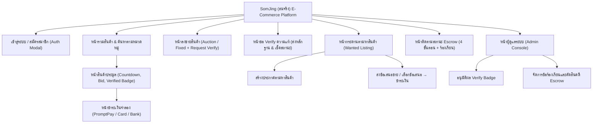
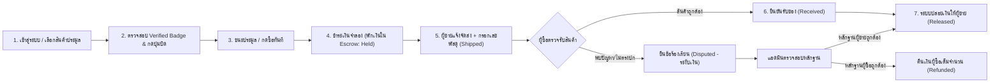
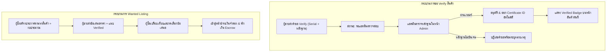

# บทที่ 5 โปรแกรมต้นแบบระบบ E-Commerce ที่พัฒนา

บทนี้นำเสนอการออกแบบและพัฒนาโปรแกรมต้นแบบ (Prototype) ระบบพาณิชย์อิเล็กทรอนิกส์ **“SomJing (สมจริง)”** แพลตฟอร์มตลาดกลางซื้อขายและประมูลสินค้าสะสม ของหายาก สนีกเกอร์ อาร์ตทอย และแก็ดเจ็ตเรโทร ที่มุ่งเน้นการแก้ปัญหาความไม่ไว้วางใจในการซื้อขายออนไลน์ผ่าน 2 กลไกหลัก ได้แก่ **ระบบตรวจรับรองความแท้ (Authenticity Verification / Verified Badge)** และ **ระบบพักเงินตัวกลาง (Escrow Payment Protection)** รวมถึงฟีเจอร์ **Wanted Listing (Reverse Marketplace)** สำหรับประกาศตามหาสินค้าหายาก

---

## 5.1 ฟีเจอร์ของโปรแกรมต้นแบบ (Minimum Viable Product: MVP)

โปรแกรมต้นแบบระบบ **SomJing (สมจริง)** พัฒนาครอบคลุมขอบเขตการทำงานหลัก (Core MVP) จำนวน 8 ฟีเจอร์สำคัญ เพื่อให้ผู้ใช้งานทุกบทบาท (ผู้ซื้อ ผู้ขาย และผู้ดูแลระบบ) สามารถทดลองใช้งานได้ครบวงจร ดังตารางที่ 5.1

| ลำดับ | ชื่อฟีเจอร์ (MVP) | รายละเอียดการทำงานในโปรแกรมต้นแบบ | บทบาทที่ใช้งาน |
| :--- | :--- | :--- | :--- |
| **1** | **สมัครสมาชิก / เข้าสู่ระบบ** | รองรับการลงทะเบียนผู้ใช้ใหม่ (กำหนดบทบาทผู้ซื้อ/ผู้ขาย) การเข้าสู่ระบบด้วยอีเมลและรหัสผ่าน และมีแถบ Demo Role Switcher สำหรับสลับบทบาททดสอบได้ทันที | ผู้ซื้อ, ผู้ขาย, แอดมิน |
| **2** | **หน้ารวมสินค้า + ค้นหาตามหมวดหมู่** | แสดงรายการสินค้าทั้งหมดในรูปแบบการ์ด พร้อมช่องค้นหาจากชื่อสินค้า/รหัสใบรับรอง (Certificate ID) ตัวกรอง 4 หมวดหมู่ ตัวกรองรูปแบบการขาย (ประมูล/ซื้อทันที) และตัวกรองเฉพาะสินค้า Verified | ผู้เยี่ยมชม, ผู้ซื้อ |
| **3** | **หน้าสินค้าประมูล (Auction Detail)** | แสดงภาพสินค้า ตรา **SomJing Verified Badge** พร้อมเลขที่ใบรับรอง ราคาประมูลปัจจุบัน เวลานับถอยหลังแบบเรียลไทม์ ปุ่มบิดประมูลด่วนและบิดกำหนดเอง ประวัติการเสนอราคา และปุ่มชำระเงินผ่าน Escrow | ผู้ซื้อ, ผู้ขาย |
| **4** | **ระบบลงขายสินค้า (Create Listing)** | ให้ผู้ขายสร้างประกาศขายได้ทั้งแบบเปิดประมูล (ตั้งราคาเริ่มต้น ขั้นต่ำในการบิด และระยะเวลาประมูล) และแบบราคาคงที่ พร้อมตัวเลือกส่งคำขอ Verify ไปพร้อมกันได้ทันที | ผู้ขาย |
| **5** | **ระบบขอรับรองความแท้ (Request Verify)** | ผู้ขายสามารถส่งคำขอตรวจสอบความแท้ของสินค้าโดยระบุ Serial Number แนบภาพถ่ายหลักฐานและคำอธิบายที่มาของสินค้า พร้อมติดตามสถานะคำขอแบบเรียลไทม์ | ผู้ขาย |
| **6** | **Wanted Listing + ส่งข้อเสนอ + เลือกข้อเสนอ** | ผู้ซื้อสร้างประกาศตามหาสินค้าพร้อมงบประมาณและสภาพที่ต้องการ ผู้ขายสามารถส่งข้อเสนอขายแข่งกันได้ และผู้ซื้อสามารถกดเลือกข้อเสนอที่ต้องการเพื่อเข้าสู่การชำระเงิน Escrow | ผู้ซื้อ, ผู้ขาย |
| **7** | **ชำระเงินจำลอง + สถานะ Escrow** | จำลองการชำระเงินผ่าน PromptPay QR, บัตรเครดิต/เดบิต และ Mobile Banking พร้อมวงจร Escrow 4 ขั้นตอน (**พักเงิน → จัดส่ง → ยืนยันรับของ → ปล่อยเงิน**) และบันทึกประวัติธุรกรรม | ผู้ซื้อ, ผู้ขาย |
| **8** | **หน้าแอดมิน (Admin Console)** | ศูนย์ควบคุมสำหรับตรวจสอบหลักฐานเพื่อ **อนุมัติ/ปฏิเสธ Verified Badge** (สร้างเลขที่ใบรับรองอัตโนมัติ) และ **ตรวจสอบข้อร้องเรียน** เพื่อตัดสินคืนเงินผู้ซื้อหรือปล่อยเงินให้ผู้ขาย | แอดมิน |

---

## 5.2 ผังการใช้งาน (User Flow / Sitemap)

### 5.2.1 แผนผังโครงสร้างเว็บไซต์ (Sitemap)



### 5.2.2 ผังขั้นตอนการประมูล การชำระเงิน และวงจร Escrow (Auction & Escrow User Flow)



### 5.2.3 ผังขั้นตอนการขอรับรองความแท้และการสร้าง Wanted Listing



---

## 5.3 เทคโนโลยีและเครื่องมือที่ใช้พัฒนา

การพัฒนาโปรแกรมต้นแบบมุ่งเน้นสถาปัตยกรรมเว็บแอปพลิเคชันแบบ Single Page Application (SPA) ที่ตอบสนองรวดเร็ว มีความแม่นยำของข้อมูลสถานะ (State Consistency) และสามารถติดตั้งหรือทดสอบใช้งานได้ทันทีผ่านเว็บเบราว์เซอร์ โดยมีเทคโนโลยีและเครื่องมือที่ใช้ดังตารางที่ 5.2

| หมวดหมู่ | เทคโนโลยี / เครื่องมือ | เวอร์ชัน / รายละเอียด | บทบาทในระบบ SomJing |
| :--- | :--- | :--- | :--- |
| **ภาษาและโครงสร้าง UI** | **React + TypeScript** | React 18.3, TypeScript 5.6 | พัฒนาส่วนติดต่อผู้ใช้แบบ Component-based และควบคุมชนิดข้อมูล (Strict Type Safety) ลดข้อผิดพลาดของข้อมูลราคาและสถานะ Escrow |
| **Build Tool** | **Vite** | Vite 5.4 | เครื่องมือรันเซิร์ฟเวอร์พัฒนา (Hot Module Replacement) และ Build ไฟล์ Production ที่มีขนาดเล็กและโหลดเร็ว |
| **การจัดรูปแบบ (Styling)** | **Tailwind CSS** | Tailwind CSS 3.4 | ออกแบบ Design System โทน *Warm Collector's Exchange* พร้อม Responsive Design รองรับทั้ง Desktop และ Mobile |
| **ไอคอน (Iconography)** | **Lucide React** | Lucide React 0.460 | ชุดไอคอนเวกเตอร์มาตรฐานสำหรับแสดงสัญลักษณ์ Verify, Escrow Lock, นาฬิกานับถอยหลัง และเครื่องมือแอดมิน |
| **การจัดการฟอนต์** | **Google Fonts** | Noto Sans Thai, Plus Jakarta Sans, JetBrains Mono | รองรับภาษาไทยที่อ่านง่ายคู่กับตัวเลขแบบ Monospace (`tabular-nums`) สำหรับเวลานับถอยหลัง ราคาบิด และรหัส Certificate |
| **การจัดการสถานะและข้อมูล** | **React Context API + LocalStorage** | Browser Storage Persistence (`somjing_prototype_v1`) | จำลองฐานข้อมูลในเบราว์เซอร์ ทำให้ข้อมูลการบิดประมูล คำขอ Verify ข้อเสนอ Wanted คำสั่งซื้อ Escrow และคำตัดสินแอดมินคงอยู่ต่อเนื่องและรีเซ็ตได้ใน 1 คลิก |
| **การควบคุมเวอร์ชันและโฮสติ้ง** | **Git, GitHub, Vercel** | `github.com/marchtanu/som-jing` | จัดเก็บ Source Code และรองรับการ Deploy เป็นเว็บไซต์สาธารณะเพื่อการทดลองใช้งาน |

---

## 5.4 หน้าจอและการใช้งานระบบ

โปรแกรมต้นแบบถูกออกแบบตามหลักการ **Usability และ Visual Hierarchy** โดยกำหนดความหมายของสีเพื่อสื่อสารความน่าเชื่อถือแก่ผู้ใช้งาน ได้แก่ สีเขียว Emerald (`#0D7A5F`) สำหรับสถานะผ่านการรับรองของแท้ (Verified) สีน้ำเงิน (`#1D4ED8`) สำหรับระบบคุ้มครองตัวกลาง (Escrow) และสีส้ม Vermilion (`#D94E28`) สำหรับปุ่มดำเนินการหลัก โดยมีรายละเอียดหน้าจอสำคัญ 7 ส่วน ดังนี้

1. **แถบนำทางและเครื่องมือสาธิต (Navigation & Demo Switcher):** อยู่ด้านบนสุดของทุกหน้าจอ ช่วยให้ผู้ใช้หรือผู้ประเมินระบบสามารถสลับบทบาทระหว่าง **ผู้ซื้อ (Buyer)**, **ผู้ขาย (Seller)** และ **แอดมิน (Admin)** ได้ในคลิกเดียว พร้อมปุ่ม **“รีเซ็ตข้อมูลตัวอย่าง”** และแสดงจำนวนรายการที่รอดำเนินการบนเมนู
2. **หน้าตลาดสินค้าและค้นหาตามหมวดหมู่ (Catalog & Search):** แสดงแบนเนอร์สรุปจุดขาย ช่องค้นหาอัจฉริยะ (ค้นได้ทั้งชื่อสินค้า ชื่อร้าน และเลขใบรับรอง) ปุ่มกรอง 4 หมวดหมู่ (อาร์ตทอย, สนีกเกอร์, แก็ดเจ็ต, นาฬิกา/การ์ดสะสม) ตัวกรองเฉพาะสินค้าที่ผ่าน Verify และการ์ดสินค้าที่แสดงเวลาประมูลนับถอยหลังแบบเรียลไทม์
3. **หน้าสินค้าประมูล (Live Auction Detail):** แสดงแกลเลอรีภาพสินค้า กล่องแสดงใบรับรองความแท้ (`SomJing Verified` + `Certificate ID` + ชื่อผู้ตรวจสอบ) นาฬิกานับถอยหลังระดับวินาที ปุ่มบิดประมูลด่วน (`+ขั้นต่ำ`) ช่องกรอกราคาบิดเอง ตารางประวัติผู้บิด และปุ่มเข้าสู่การชำระเงินจำลอง
4. **หน้าลงขายสินค้าและหน้าขอ Verify (Sell & Verification Request):** แบบฟอร์มลงขายที่เลือกได้ทั้งโหมดเปิดประมูลและขายราคาคงที่ พร้อมปุ่มแนบคำขอ Verify ทันที และหน้าเฉพาะสำหรับส่งคำขอตรวจความแท้พร้อมติดตามสถานะคำขอของตนเอง
5. **หน้ากระดานตามหาสินค้า (Wanted Board):** แสดงประกาศตามหาสินค้าพร้อมงบประมาณตั้งเป้าของผู้ซื้อ ฟอร์มสร้าง Wanted Listing ใหม่ และส่วนยื่นข้อเสนอ (Submit Offer) ที่ผู้ซื้อสามารถเปรียบเทียบราคา สภาพ และสถานะ Verify ก่อนกดปุ่ม **“เลือกข้อเสนอ & ชำระ Escrow”**
6. **หน้าชำระเงินจำลองและติดตามสถานะ Escrow:**
   - **หน้าต่างชำระเงินจำลอง (Simulated Payment Modal):** แสดงยอดสินค้าบวกค่าธรรมเนียมคุ้มครอง Escrow 2% และจำลองการชำระผ่าน PromptPay QR / บัตรเครดิต / แอปธนาคาร
   - **หน้าติดตามสถานะ (Escrow Tracker):** แสดงแถบความคืบหน้า 4 ขั้นตอน (**1. พักเงิน → 2. จัดส่ง → 3. ยืนยันรับของ → 4. ปล่อยเงิน**) พร้อมปุ่มจำลองการเปลี่ยนสถานะทีละขั้นและบันทึกเวลา (Audit Log) รวมถึงปุ่มแจ้งปัญหา/ร้องเรียน
7. **หน้าผู้ดูแลระบบ (Admin Console):** แสดงตัวเลขภาพรวม (KPI) และคิวงาน 2 ส่วนหลัก คือ คิวตรวจหลักฐานเพื่อกด **อนุมัติ/ไม่อนุมัติ Verified Badge** และคิวจัดการ **ข้อร้องเรียน Escrow** เพื่อตัดสินคืนเงินผู้ซื้อหรือปล่อยเงินให้ผู้ขาย

---

## 5.5 ความปลอดภัยและระบบการชำระเงิน

ระบบ **SomJing (สมจริง)** ให้ความสำคัญกับความมั่นคงปลอดภัยของธุรกรรมพาณิชย์อิเล็กทรอนิกส์บน 4 เสาหลัก ดังนี้

1. **กลไกการพักเงินตัวกลาง (Escrow Payment Protection):**
   - เมื่อผู้ซื้อชำระเงินค่าสินค้าผ่านช่องทางจำลอง ระบบจะเปลี่ยนสถานะเป็น `held` (พักเงินในระบบ) โดยเงินจะยังไม่ถูกโอนเข้าบัญชีผู้ขายโดยตรง
   - ผู้ขายต้องดำเนินการจัดส่งและกรอกเลขพัสดุเข้าสู่ระบบ (`shipped`) จากนั้นเมื่อผู้ซื้อได้รับของและตรวจสอบความถูกต้องแล้วจึงกดยืนยันรับของ (`received`) ระบบจึงจะปลดล็อกและโอนเงินให้ผู้ขาย (`released`) ช่วยลดความเสี่ยงการหลอกโอนเงินแล้วไม่ส่งสินค้า (Non-delivery Fraud) ได้อย่างเป็นระบบ
2. **การตรวจรับรองความแท้และการออกรหัสใบรับรอง (Authenticity Verification & Certificate ID):**
   - สินค้าที่ผ่านการตรวจหลักฐาน (Serial Number, จุดสังเกตเฉพาะรุ่น, ใบเสร็จ) และได้รับอนุมัติจากผู้ดูแลระบบจะได้รับรหัสใบรับรองเฉพาะรายการ (เช่น `SJ-CERT-2026-8841`) แสดงควบคู่กับ **Verified Badge** เพื่อลดปัญหาการจำหน่ายสินค้าลอกเลียนแบบ
3. **กลไกระงับเงินเมื่อเกิดข้อพิพาท (Dispute Freeze & Audit Trail):**
   - หากสินค้าไม่ตรงตามประกาศหรือเกิดความเสียหายระหว่างขนส่ง ผู้ซื้อสามารถกดยื่นข้อร้องเรียนจากหน้าคำสั่งซื้อ ซึ่งระบบจะเปลี่ยนสถานะเป็น `disputed` เพื่อระงับการปล่อยเงินชั่วคราวโดยอัตโนมัติ และส่งเรื่องไปยังหน้าแอดมินพร้อมบันทึกประวัติการทำรายการ (Timestamp Audit Log) เพื่อใช้ประกอบการพิจารณาตัดสินอย่างเป็นธรรม
4. **ข้อจำกัดและแนวทางยกระดับสู่ระบบใช้งานจริง (Production Security Roadmap):**
   - ในเวอร์ชันต้นแบบการชำระเงินเป็นการจำลอง Sandbox ในฝั่ง Frontend เพื่อความปลอดภัยทางการสาธิต สำหรับการใช้งานจริงในเชิงพาณิชย์จะต้องเชื่อมต่อ Payment Gateway ที่ได้รับใบอนุญาตมาตรฐาน **PCI-DSS** (เช่น Omise, 2C2P หรือ Stripe) ใช้การเข้ารหัสการสื่อสารด้วย **HTTPS/TLS**, การเข้ารหัสรหัสผ่านด้วย **bcrypt/Argon2**, การยืนยันตัวตนด้วย **JWT / OAuth 2.0** และระบบยืนยันตัวตนผู้ขาย (**e-KYC**)

---

## 5.6 กฎหมายและจริยธรรมที่เกี่ยวข้อง

การพัฒนาและให้บริการแพลตฟอร์มตลาดกลางซื้อขาย-ประมูลของสะสมในประเทศไทยต้องคำนึงถึงกรอบกฎหมายและจริยธรรมทางดิจิทัลที่สำคัญ ดังนี้

1. **พ.ร.บ. คุ้มครองข้อมูลส่วนบุคคล พ.ศ. 2562 (PDPA):**
   - ระบบจัดเก็บข้อมูลส่วนบุคคล (ชื่อ อีเมล เบอร์โทรศัพท์ และหลักฐานการยืนยันสินค้า) ตามหลักการเก็บข้อมูลเท่าที่จำเป็น (Data Minimization) และใช้เพื่อวัตถุประสงค์ในการทำธุรกรรม ตรวจรับรองความแท้ และระงับข้อพิพาทเท่านั้น ในเวอร์ชันจริงต้องแสดงนโยบายความเป็นส่วนตัว (Privacy Policy) และขอความยินยอม (Consent) ก่อนประมวลผลข้อมูล
2. **พ.ร.บ. ว่าด้วยธุรกรรมทางอิเล็กทรอนิกส์ พ.ศ. 2544 และที่แก้ไขเพิ่มเติม:**
   - การเสนอราคาประมูล (Bidding) และการกดยืนยันคำสั่งซื้อผ่านระบบอิเล็กทรอนิกส์ถือเป็นหลักฐานการแสดงเจตนาทางนิติกรรม ระบบจึงบันทึกผู้ทำรายการ ราคา และวันเวลา (Timestamp) อย่างชัดเจนในประวัติการบิดและ Escrow Audit Log เพื่อใช้อ้างอิงทางกฎหมายได้
3. **พ.ร.บ. คุ้มครองผู้บริโภค พ.ศ. 2522 และ พ.ร.บ. ขายตรงและตลาดแบบตรง:**
   - แพลตฟอร์มต้องแสดงราคาสินค้า ค่าธรรมเนียมบริการ Escrow (2%) สภาพสินค้าจริง และเงื่อนไขการคืนเงินอย่างโปร่งใส ไม่โฆษณาเกินจริง และมีช่องทางร้องเรียนเมื่อผู้บริโภคไม่ได้รับความเป็นธรรม
4. **กฎหมายทรัพย์สินทางปัญญา (พ.ร.บ. ลิขสิทธิ์ และ พ.ร.บ. เครื่องหมายการค้า):**
   - เนื่องจากสินค้าบนแพลตฟอร์มเป็นแบรนด์เนมและของสะสมลิขสิทธิ์ ระบบจึงมีกระบวนการ **Verify ความแท้** และสิทธิ์ของแอดมินในการปฏิเสธสินค้าที่ไม่ผ่านการตรวจสอบ เพื่อป้องกันการแพร่กระจายสินค้าละเมิดเครื่องหมายการค้าบนแพลตฟอร์ม
5. **พ.ร.บ. ว่าด้วยการกระทำความผิดเกี่ยวกับคอมพิวเตอร์ พ.ศ. 2550 (และฉบับที่ 2 พ.ศ. 2560):**
   - ห้ามการนำเข้าข้อมูลอันเป็นเท็จ การปั่นราคาประมูลหลอกลวง (Shill Bidding) หรือการแอบอ้างหลักฐานความแท้ปลอม โดยระบบบันทึกผู้เสนอราคาและคำร้องเรียนเพื่อตรวจสอบย้อนกลับได้
6. **จริยธรรมของแพลตฟอร์มตัวกลาง (Platform Ethics):**
   - ผู้ดูแลระบบต้องทำหน้าที่ตัดสินข้อร้องเรียนระหว่างผู้ซื้อและผู้ขายด้วยความเป็นกลาง โปร่งใส ยึดตามหลักฐานจริงในระบบ Escrow ไม่เลือกปฏิบัติ และคุ้มครองสิทธิของทั้งสองฝ่ายอย่างสมดุล

---

## 5.7 ช่องทางทดลองใช้งานระบบ

ผู้สนใจและคณะกรรมการประเมินโครงงานสามารถเข้าถึงซอร์สโค้ดและทดลองใช้งานโปรแกรมต้นแบบ **SomJing (สมจริง)** ได้ผ่านช่องทางดังต่อไปนี้

* **ซอร์สโค้ดบน GitHub:** [https://github.com/marchtanu/som-jing](https://github.com/marchtanu/som-jing)
* **การรันบนเครื่องท้องถิ่น (Local Development):**
  ```bash
  git clone https://github.com/marchtanu/som-jing.git
  cd som-jing
  npm install
  npm run dev
  ```
* **บัญชีทดสอบสำเร็จรูป (Demo Accounts — รหัสผ่านทั้งหมดคือ `password123`):**
  * **ผู้ซื้อ (Buyer):** `buyer@somjing.com` *(คุณธนภัทร)*
  * **ผู้ขาย (Seller):** `seller@somjing.com` *(คุณกิตติพงศ์ - Kitti Collectibles)*
  * **แอดมิน (Admin):** `admin@somjing.com` *(ทีมผู้ตรวจสอบ SomJing)*
  * *(หมายเหตุ: ผู้ใช้สามารถคลิกแถบ **“สลับบทบาทสาธิต (Demo Switcher)”** ด้านบนสุดของหน้าเว็บเพื่อเปลี่ยนบทบาทได้ทันทีโดยไม่ต้องกรอกรหัสผ่านใหม่ และสามารถกด **“รีเซ็ตข้อมูลตัวอย่าง”** เพื่อเริ่มต้นการสาธิตใหม่ได้ตลอดเวลา)*

### ลำดับขั้นตอนแนะนำสำหรับการทดสอบ (Evaluation Walkthrough)
1. **ทดสอบหน้าหน้ารวมสินค้าและประมูล:** ค้นหาสินค้าในหมวดต่าง ๆ คลิกเข้าชมรายการ `BE@RBRICK 1000% KAWS` สังเกต **Verified Badge**, **เวลานับถอยหลัง**, ลองกด **ปุ่มบิดประมูล** แล้วกด **“จำลองชนะประมูล & ชำระ Escrow”**
2. **ทดสอบระบบชำระเงินจำลองและ Escrow 4 ขั้นตอน:** เลือกช่องทาง PromptPay QR แล้วกดยืนยัน จากนั้นในหน้า **สถานะ Escrow** ทดลองกด **แจ้งจัดส่งสินค้า → ยืนยันรับของถูกต้อง → ปล่อยเงินให้ผู้ขาย** ตามลำดับ
3. **ทดสอบ Wanted Listing:** ไปที่แท็บ **Wanted Board** กด **สร้าง Wanted Listing** จากนั้นลองกด **ส่งข้อเสนอขายสินค้า** และกด **เลือกข้อเสนอ & ชำระ Escrow**
4. **ทดสอบการลงขาย ขอ Verify และอนุมัติโดยแอดมิน:** ลงขายสินค้าในแท็บ **ลงขายสินค้า** (หรือส่งคำขอในแท็บ **ขอ Verify**) จากนั้นสลับบทบาทเป็น **แอดมิน** ไปที่แท็บ **หน้าแอดมิน** เพื่อกด **อนุมัติ Verified Badge** และทดสอบกด **ตัดสินข้อร้องเรียน (Refund / Release)**
