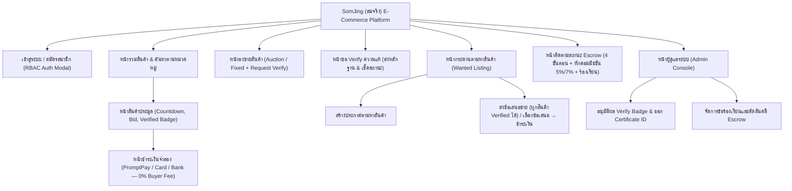
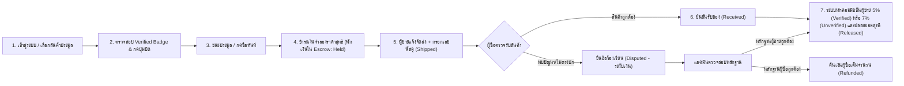
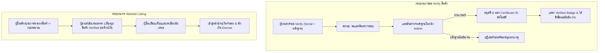

# บทที่ 5 โปรแกรมต้นแบบระบบ E-Commerce ที่พัฒนา

บทนี้นำเสนอการออกแบบและพัฒนาโปรแกรมต้นแบบ (Prototype) ระบบพาณิชย์อิเล็กทรอนิกส์ **“SomJing (สมจริง)”** แพลตฟอร์มตลาดกลางซื้อขายและประมูลสินค้าสะสม ของหายาก Art Toy การ์ดสะสม สนีกเกอร์ นาฬิกา และสินค้า Limited Edition ที่มุ่งเน้นการแก้ปัญหาความไม่ไว้วางใจในการซื้อขายแบบ C2C ผ่าน 2 กลไกหลัก ได้แก่ **ระบบตรวจรับรองความแท้ (Authenticity Verification / Verified Badge)** และ **ระบบพักเงินตัวกลาง (Escrow Payment Protection)** ควบคู่กับฟีเจอร์ **Wanted Listing (Reverse Marketplace)** สำหรับประกาศตามหาสินค้าหายาก

---

## 5.1 ฟีเจอร์ของโปรแกรมต้นแบบ (Minimum Viable Product: MVP)

โปรแกรมต้นแบบระบบ **SomJing (สมจริง)** พัฒนาครอบคลุมขอบเขตการทำงานหลัก (Core MVP) จำนวน 8 ฟีเจอร์สำคัญ เพื่อให้ผู้ใช้งานทุกบทบาท (ผู้ซื้อ ผู้ขาย และผู้ดูแลระบบ) สามารถทดลองใช้งานได้ครบวงจร ดังตารางที่ 5.1

**ตารางที่ 5.1: สรุปฟีเจอร์หลัก (MVP) ของโปรแกรมต้นแบบ SomJing**

| ลำดับ | ชื่อฟีเจอร์ (MVP) | รายละเอียดการทำงานในโปรแกรมต้นแบบ | บทบาทที่ใช้งาน |
| :--- | :--- | :--- | :--- |
| **1** | **สมัครสมาชิก / เข้าสู่ระบบแบบแยกสิทธิ์ (RBAC)** | รองรับการลงทะเบียนผู้ใช้ใหม่ (ผู้ซื้อ/ผู้ขาย ป้องกันการสมัครสิทธิ์แอดมินจากหน้าสาธารณะ) การเข้าสู่ระบบด้วยอีเมลและรหัสผ่านจริง และสิทธิ์อัปเกรดบัญชีผู้ซื้อเป็นผู้ขาย (Upgrade to Seller) โดยบังคับสิทธิ์ตามบทบาทอย่างเข้มงวด | ผู้ซื้อ, ผู้ขาย, แอดมิน |
| **2** | **หน้ารวมสินค้า + ค้นหาตามหมวดหมู่** | แสดงรายการสินค้าทั้งหมดในรูปแบบการ์ดพร้อมปุ่มเลือกตัวเลือกสินค้า (Option Swatches) ช่องค้นหาจากชื่อสินค้า/ผู้ขาย/รหัสใบรับรอง (Certificate ID) ตัวกรองหมวดหมู่สินค้า (ในต้นแบบจำลอง 4 หมวดหลัก: Art Toys, Sneakers, Retro Gadgets และ Watches) ตัวกรองรูปแบบการขาย (ประมูล/ซื้อทันที) รายการโปรด (Watchlist) และตัวกรองเฉพาะสินค้า Verified | ผู้เยี่ยมชม, ผู้ซื้อ |
| **3** | **หน้าสินค้าประมูล (Live Auction Detail)** | แสดงภาพสินค้า ตรา **SomJing Verified Badge** พร้อมเลขที่ใบรับรอง ตารางสเปคสินค้า ตัวเลือก Edition/Size ที่เชื่อมตรงกับการ์ด ราคาประมูลปัจจุบัน เวลานับถอยหลังแบบเรียลไทม์ ปุ่มบิดประมูลด่วนและบิดกำหนดเอง ประวัติการเสนอราคา และปุ่มชำระเงินผ่าน Escrow (ป้องกันผู้ขายบิดสินค้าของตนเองและป้องกัน Admin เข้าร่วมประมูล) | ผู้ซื้อ, ผู้ขาย |
| **4** | **ระบบลงขายสินค้า (Create Listing)** | ให้ผู้ขายสร้างประกาศขายได้ทั้งแบบเปิดประมูล (ตั้งราคาเริ่มต้น ราคาซื้อทันที ขั้นต่ำในการบิด และระยะเวลาประมูล) และแบบราคาคงที่ พร้อมกำหนดตัวเลือกสินค้า (Options/Editions) และส่งคำขอ Verify ไปพร้อมกันได้ทันที | ผู้ขาย |
| **5** | **ระบบขอรับรองความแท้ (Request Verify)** | ผู้ขายสามารถส่งคำขอตรวจสอบความแท้ของสินค้าโดยระบุ Serial Number แนบภาพถ่ายหลักฐานและคำอธิบายที่มาของสินค้า พร้อมติดตามสถานะคำขอแบบเรียลไทม์ (สินค้าที่ผ่าน Verify ได้รับสิทธิ์ค่าคอมมิชชันผู้ขาย 5% จากปกติ 7%) | ผู้ขาย |
| **6** | **Wanted Listing + ส่งข้อเสนอ + เลือกข้อเสนอ** | ผู้ซื้อสร้างประกาศตามหาสินค้าพร้อมงบประมาณและสภาพที่ต้องการ ผู้ขายสามารถส่งข้อเสนอขายแข่งกันได้ (ทั้งแบบ Unverified หรือผูกกับสินค้า Verified ที่มี Certificate ID ของร้านตนเอง) และผู้ซื้อที่เป็นเจ้าของประกาศสามารถกดเลือกข้อเสนอที่ต้องการเพื่อเข้าสู่การชำระเงิน Escrow | ผู้ซื้อ, ผู้ขาย |
| **7** | **ชำระเงินจำลอง + สถานะ Escrow & ค่าคอมมิชชันผู้ขาย** | จำลองการชำระเงินผ่าน PromptPay QR, บัตรเครดิต/เดบิต และ Mobile Banking โดย**ไม่มีค่าธรรมเนียม Escrow บวกเพิ่มฝั่งผู้ซื้อ** พร้อมวงจร Escrow 4 ขั้นตอน (**พักเงิน → จัดส่ง → ยืนยันรับของ → ปล่อยเงิน**) ที่หักค่าคอมมิชชันฝั่งผู้ขาย **5% (Verified)** หรือ **7% (Unverified)** เมื่อปล่อยเงิน และบันทึกประวัติธุรกรรม (Audit Log) | ผู้ซื้อ, ผู้ขาย |
| **8** | **หน้าแอดมิน (Admin Console)** | ศูนย์ควบคุมเฉพาะบัญชีผู้ดูแลระบบสำหรับตรวจสอบหลักฐานเพื่อ **อนุมัติ/ปฏิเสธ Verified Badge** (ออกเลขที่ใบรับรอง `SJ-CERT-2026-xxxx` อัตโนมัติ) และ **ตรวจสอบข้อร้องเรียน Escrow** เพื่อตัดสินคืนเงินผู้ซื้อเต็มจำนวนหรือปล่อยเงินสุทธิให้ผู้ขาย | แอดมิน |

---

## 5.2 ผังการใช้งาน (User Flow / Sitemap)

### 5.2.1 แผนผังโครงสร้างเว็บไซต์ (Sitemap)



### 5.2.2 ผังขั้นตอนการประมูล การชำระเงิน และวงจร Escrow (Auction & Escrow User Flow)



### 5.2.3 ผังขั้นตอนการขอรับรองความแท้และการสร้าง Wanted Listing



---

## 5.3 เทคโนโลยีและเครื่องมือที่ใช้พัฒนา

การพัฒนาโปรแกรมต้นแบบมุ่งเน้นสถาปัตยกรรมเว็บแอปพลิเคชันแบบ Single Page Application (SPA) ที่ตอบสนองรวดเร็ว มีความแม่นยำในการคำนวณราคาและค่าคอมมิชชันระดับสตางค์ (Satang-accurate Settlement) และสามารถทดสอบได้ทันทีผ่านเว็บเบราว์เซอร์ โดยมีเทคโนโลยีและเครื่องมือที่ใช้ดังตารางที่ 5.2

**ตารางที่ 5.2: เทคโนโลยีและเครื่องมือที่ใช้ในการพัฒนาโปรแกรมต้นแบบ SomJing**

| หมวดหมู่ | เทคโนโลยี / เครื่องมือ | เวอร์ชัน / รายละเอียด | บทบาทในระบบ SomJing |
| :--- | :--- | :--- | :--- |
| **ภาษาและโครงสร้าง UI** | **React + TypeScript** | React 18.3, TypeScript 5.6 | พัฒนาส่วนติดต่อผู้ใช้แบบ Component-based และควบคุมชนิดข้อมูล (Strict Type Safety) ลดข้อผิดพลาดของข้อมูลราคา ค่าคอมมิชชัน 5%/7% และสถานะ Escrow |
| **Build Tool** | **Vite** | Vite 5.4 | เครื่องมือรันเซิร์ฟเวอร์พัฒนา (Hot Module Replacement) และ Build ไฟล์ Production ที่มีขนาดเล็กและโหลดเร็ว |
| **การจัดรูปแบบ (Styling)** | **Tailwind CSS** | Tailwind CSS 3.4 | ออกแบบ Design System แนว *High-Contrast Editorial Commerce* (`#111111` Ink, `#FFFFFF` Canvas, `#F5F5F5` Soft Cloud, `30px` Pill CTA, `1px` Hairline) รองรับ Responsive ทั้ง Desktop และ Mobile |
| **ไอคอน (Iconography)** | **Lucide React** | Lucide React 0.460 | ชุดไอคอนเวกเตอร์มาตรฐานสำหรับแสดงสัญลักษณ์ Verify, Escrow Lock, นาฬิกานับถอยหลัง และเครื่องมือแอดมิน |
| **การจัดการฟอนต์** | **Google Fonts** | Bebas Neue, Inter, Noto Sans Thai, JetBrains Mono | ผสาน Display Typography สำหรับแคมเปญ Hero เข้ากับตัวอักษรภาษาไทยที่อ่านง่ายและตัวเลข Monospace (`tabular-nums`) สำหรับเวลานับถอยหลัง ราคาบิด และรหัส Certificate |
| **การจัดการสถานะและข้อมูล** | **React Context API + LocalStorage** | Browser Storage Persistence (`somjing_prototype_v2`) | จำลองฐานข้อมูลในเบราว์เซอร์ ทำให้ข้อมูลการบิดประมูล คำขอ Verify ข้อเสนอ Wanted คำสั่งซื้อ Escrow และคำตัดสินแอดมินคงอยู่ต่อเนื่องและรีเซ็ตได้ใน 1 คลิก |
| **การทดสอบอัตโนมัติ** | **Vitest + React Testing Library** | Vitest 2.1, RTL 16.3 | ชุดทดสอบอัตโนมัติ 17 กรณี (`TC-01` ถึง `TC-16` และกรณีเชื่อมโยงสินค้า Verified ใน Wanted) ตรวจสอบ RBAC, การบิดประมูล, การคำนวณค่าคอมมิชชัน 5%/7% และวงจร Escrow |
| **การควบคุมเวอร์ชันและโฮสติ้ง** | **Git, GitHub, GitHub Pages / Vercel** | `github.com/marchtanu/som-jing` | จัดเก็บ Source Code ควบคุมเวอร์ชัน และ Deploy เป็นเว็บไซต์สาธารณะเพื่อการทดลองใช้งาน |

---

## 5.4 หน้าจอและการใช้งานระบบ

โปรแกรมต้นแบบถูกออกแบบตามหลักการ **Editorial Photography & Mechanical Restraint** โดยใช้คู่สีหลักขาว-ดำ-เทาอ่อน (`#FFFFFF` Canvas, `#111111` Ink, `#F5F5F5` Soft Cloud) เพื่อขับภาพถ่ายสินค้าให้โดดเด่น ใช้ภาพสินค้าอัตราส่วน 1:1 เต็มขอบ ปุ่มทรง Pill (`30px`) สำหรับการกระทำหลัก เส้นแบ่ง Hairline (`#CACACB`) แทนเงา และสงวนสีเฉพาะจุดที่มีความหมายสำคัญ ได้แก่ สีเขียว Success (`#007D48`) สำหรับสถานะ **Verified** และสีแดง (`#D30005`) สำหรับเวลานับถอยหลังประมูลและข้อร้องเรียน โดยมีรายละเอียดหน้าจอสำคัญ 7 ส่วน ดังนี้

1. **แถบนำทางและระบบจัดการบัญชี (Navigation & Role-Based Access Control):** แสดงเมนูเฉพาะตามบทบาทจริง (Guest, Buyer, Seller, Admin) รายการที่บันทึก (Watchlist) และจำนวนคำสั่งซื้อ Escrow โดยระบบซ่อนเมนู Admin Console จากผู้ใช้ทั่วไปและต้องลงชื่อเข้าใช้ด้วยบัญชีผู้ดูแลระบบจริงเท่านั้นจึงจะเข้าถึงได้ รวมถึงมีปุ่มเปิดสิทธิ์บัญชีผู้ขาย (Upgrade to Seller) ภายในหน้าจัดการบัญชี
2. **หน้าตลาดสินค้าและค้นหาตามหมวดหมู่ (Catalog, Swatches & Watchlist):** แสดงแคมเปญแบนเนอร์ ช่องค้นหาอัจฉริยะ (ชื่อสินค้า/ผู้ขาย/Certificate ID) ตัวกรองหมวดหมู่ ตัวกรอง Verified Only และ Saved Watchlist พร้อมปุ่มเลือกตัวเลือกสินค้า (Option Swatches) บนการ์ดที่เชื่อมตรงกับหน้ารายละเอียดสินค้า
3. **หน้าสินค้าประมูล (Live Auction Detail):** แสดงแกลเลอรีภาพสินค้า ตัวเลือก Edition/Size ตารางสเปคสินค้า ตรา `SomJing Verified` + `Certificate ID` นาฬิกานับถอยหลังระดับวินาที ปุ่มบิดประมูลด่วน ช่องกรอกราคาบิดเอง และประวัติการเสนอราคา (ป้องกันผู้ขายประมูลสินค้าของตนเองและป้องกัน Admin เข้าร่วมประมูล)
4. **หน้าลงขายสินค้าและหน้าขอ Verify (Sell & Verification Request):** แบบฟอร์มลงขายที่เลือกได้ทั้งโหมดเปิดประมูลและขายราคาคงที่ กำหนดตัวเลือกสินค้าได้เอง พร้อมตัวเลือกส่งคำขอ Verify ทันที และหน้าเฉพาะสำหรับส่งคำขอตรวจความแท้โดยแจ้งสิทธิ์ลดค่าคอมมิชชันผู้ขายจาก 7% เหลือ 5% เมื่อผ่านการรับรอง
5. **หน้ากระดานตามหาสินค้า (Wanted Board):** แสดงประกาศตามหาสินค้าพร้อมงบประมาณตั้งเป้าของผู้ซื้อ ฟอร์มสร้าง Wanted Listing ใหม่ และส่วนยื่นข้อเสนอ (Submit Offer) ที่ให้ผู้ขายสามารถเลือกผูกกับสินค้า **Verified** ในร้านของตนเองเพื่อแนบ `Certificate ID` จริง (ป้องกันการแอบอ้างสถานะ Verified) ก่อนที่เจ้าของประกาศจะกดปุ่ม **“เลือกข้อเสนอ & ชำระ Escrow”**
6. **หน้าชำระเงินจำลองและติดตามสถานะ Escrow:**
   - **หน้าต่างชำระเงินจำลอง (Simulated Payment Modal):** แสดงราคาสินค้าสุทธิที่ผู้ซื้อต้องชำระ (ไม่มีค่าธรรมเนียม Escrow บวกเพิ่มฝั่งผู้ซื้อ) กรอกที่อยู่จัดส่ง และจำลองการชำระผ่าน PromptPay QR / บัตรเครดิต / แอปธนาคาร
   - **หน้าติดตามสถานะ (Escrow Tracker):** แสดงแถบความคืบหน้า 4 ขั้นตอน (**1. พักเงิน → 2. จัดส่ง → 3. ยืนยันรับของ → 4. ปล่อยเงิน**) บังคับสิทธิ์ผู้ขาย/ผู้ซื้อในแต่ละขั้น แสดงยอดสุทธิผู้ขายหลังหักค่าคอมมิชชัน **5% (Verified)** หรือ **7% (Unverified)** บันทึกเวลา (Audit Log) และมีปุ่มแจ้งปัญหา/ร้องเรียน
7. **หน้าผู้ดูแลระบบ (Admin Console):** แสดงตัวเลขภาพรวม (KPI) และคิวงาน 2 ส่วนหลัก คือ คิวตรวจหลักฐานเพื่อกด **อนุมัติ/ไม่อนุมัติ Verified Badge** และคิวจัดการ **ข้อร้องเรียน Escrow** เพื่อตัดสินคืนเงินผู้ซื้อเต็มจำนวนหรือปล่อยยอดสุทธิให้ผู้ขาย

*(หมายเหตุสำหรับจัดทำรูปเล่ม: แทรกภาพหน้าจอจริงทั้ง 7 ส่วนเป็นรูปภาพที่ 5.4 – 5.10 ใต้หัวข้อนี้)*

---

## 5.5 ความปลอดภัยและระบบการชำระเงิน

ระบบ **SomJing (สมจริง)** ให้ความสำคัญกับความมั่นคงปลอดภัยของธุรกรรมพาณิชย์อิเล็กทรอนิกส์บน 4 เสาหลัก ดังนี้

1. **กลไกการพักเงินตัวกลางและโครงสร้างค่าคอมมิชชันผู้ขาย (Escrow Payment Protection & Seller Commission):**
   - เมื่อผู้ซื้อชำระเงินราคาสุทธิของสินค้าผ่านช่องทางจำลอง (**ไม่มีค่าธรรมเนียม Escrow บวกเพิ่มฝั่งผู้ซื้อ**) ระบบจะเปลี่ยนสถานะเป็น `held` (พักเงินในระบบตัวกลาง) โดยเงินจะยังไม่ถูกโอนให้ผู้ขายโดยตรง
   - ผู้ขายต้องดำเนินการจัดส่งและกรอกเลขพัสดุเข้าสู่ระบบ (`shipped`) จากนั้นเมื่อผู้ซื้อได้รับของและตรวจสอบความถูกต้องแล้วจึงกดยืนยันรับของ (`received`) ระบบจึงจะปลดล็อกและคำนวณหักค่าคอมมิชชันฝั่งผู้ขาย (**5% สำหรับสินค้า Verified** หรือ **7% สำหรับสินค้า Unverified** ซึ่งครอบคลุมต้นทุนระบบพักเงินและ Payment Gateway แล้ว) และปล่อยยอดสุทธิให้ผู้ขาย (`released`) ช่วยลดความเสี่ยงการหลอกโอนเงินแล้วไม่ส่งสินค้า (Non-delivery Fraud)
2. **การตรวจรับรองความแท้และการออกรหัสใบรับรอง (Authenticity Verification & Certificate ID):**
   - สินค้าที่ผ่านการตรวจหลักฐาน (Serial Number, จุดสังเกตเฉพาะรุ่น, ใบเสร็จ) และได้รับอนุมัติจากผู้ดูแลระบบจะได้รับรหัสใบรับรองเฉพาะรายการ (เช่น `SJ-CERT-2026-8841`) แสดงควบคู่กับ **Verified Badge** และในฟีเจอร์ Wanted Offer ระบบบังคับให้ผู้ขายต้องผูกกับสินค้า Verified จริงในร้านเท่านั้นจึงจะแสดงตรา Verified ได้ ช่วยลดปัญหาสินค้าลอกเลียนแบบและการแอบอ้างใบรับรอง
3. **กลไกระงับเงินเมื่อเกิดข้อพิพาท (Dispute Freeze & Audit Trail):**
   - หากสินค้าไม่ตรงตามประกาศหรือเกิดความเสียหายระหว่างขนส่ง ผู้ซื้อสามารถกดยื่นข้อร้องเรียนจากหน้าคำสั่งซื้อ ซึ่งระบบจะเปลี่ยนสถานะเป็น `disputed` เพื่อระงับการปล่อยเงินชั่วคราวโดยอัตโนมัติ และส่งเรื่องไปยังหน้าแอดมินพร้อมบันทึกประวัติการทำรายการ (Timestamp Audit Log) เพื่อใช้ประกอบการพิจารณาตัดสินอย่างเป็นธรรม
4. **ข้อจำกัดและแนวทางยกระดับสู่ระบบใช้งานจริง (Production Security Roadmap):**
   - ในเวอร์ชันต้นแบบการชำระเงินเป็นการจำลอง Sandbox ในฝั่ง Frontend เพื่อความปลอดภัยทางการสาธิต สำหรับการใช้งานจริงในเชิงพาณิชย์จะต้องเชื่อมต่อ Payment Gateway ที่ได้รับอนุญาตตามกฎหมายและได้มาตรฐาน **PCI-DSS** (เช่น Omise, 2C2P หรือ Stripe) เพื่อพักเงินและโอนชำระอย่างถูกต้อง ใช้การเข้ารหัสการสื่อสารด้วย **HTTPS/TLS**, การเข้ารหัสรหัสผ่านด้วย **bcrypt/Argon2**, การยืนยันตัวตนด้วย **JWT / OAuth 2.0** และระบบยืนยันตัวตนผู้ขาย (**e-KYC**)

---

## 5.6 กฎหมายและจริยธรรมที่เกี่ยวข้อง

การพัฒนาและให้บริการแพลตฟอร์มตลาดกลางซื้อขาย-ประมูลของสะสมในประเทศไทยต้องคำนึงถึงกรอบกฎหมายและจริยธรรมทางดิจิทัลที่สำคัญ ดังนี้

1. **พ.ร.บ. ระบบการชำระเงิน พ.ศ. 2560 (Payment Systems Act):**
   - เนื่องจากระบบ Escrow มีการรับและพักเงินแทนผู้ซื้อและผู้ขาย ซึ่งอยู่ภายใต้การกำกับดูแลของธนาคารแห่งประเทศไทย (ธปท.) ในการใช้งานจริงเชิงพาณิชย์ SomJing จึงต้องดำเนินการรับชำระและพักเงินผ่าน **ผู้ให้บริการรับชำระเงินที่ได้รับใบอนุญาต (Licensed Payment Gateway / Escrow Partner)** เช่น Omise โดยไม่ถือครองเงินลูกค้าในบัญชีส่วนบุคคลหรือบัญชีบริษัทโดยไม่ได้รับอนุญาต
2. **พ.ร.บ. คุ้มครองข้อมูลส่วนบุคคล พ.ศ. 2562 (PDPA):**
   - ระบบจัดเก็บข้อมูลส่วนบุคคล (ชื่อ อีเมล เบอร์โทรศัพท์ ที่อยู่จัดส่ง และหลักฐานการยืนยันสินค้า) ตามหลักการเก็บข้อมูลเท่าที่จำเป็น (Data Minimization) และใช้เพื่อวัตถุประสงค์ในการทำธุรกรรม ตรวจรับรองความแท้ และระงับข้อพิพาทเท่านั้น ในเวอร์ชันจริงต้องแสดงนโยบายความเป็นส่วนตัว (Privacy Policy) และขอความยินยอม (Consent) ก่อนประมวลผลข้อมูล
3. **พ.ร.บ. ว่าด้วยธุรกรรมทางอิเล็กทรอนิกส์ พ.ศ. 2544 และที่แก้ไขเพิ่มเติม:**
   - การเสนอราคาประมูล (Bidding) และการกดยืนยันคำสั่งซื้อผ่านระบบอิเล็กทรอนิกส์ถือเป็นหลักฐานการแสดงเจตนาทางนิติกรรม ระบบจึงบันทึกผู้ทำรายการ ราคา และวันเวลา (Timestamp) อย่างชัดเจนในประวัติการบิดและ Escrow Audit Log เพื่อใช้อ้างอิงทางกฎหมายได้
4. **พ.ร.บ. คุ้มครองผู้บริโภค พ.ศ. 2522 และ พ.ร.บ. ขายตรงและตลาดแบบตรง:**
   - แพลตฟอร์มต้องแสดงราคาสินค้าสุทธิฝั่งผู้ซื้อ ค่าคอมมิชชันผู้ขาย (5% สำหรับ Verified / 7% สำหรับ Unverified) ค่าบริการตรวจความแท้ สภาพสินค้าจริง และเงื่อนไขการคืนเงินอย่างโปร่งใส ไม่โฆษณาเกินจริง และมีช่องทางร้องเรียนเมื่อผู้บริโภคไม่ได้รับความเป็นธรรม
5. **กฎหมายทรัพย์สินทางปัญญา (พ.ร.บ. ลิขสิทธิ์ และ พ.ร.บ. เครื่องหมายการค้า):**
   - เนื่องจากสินค้าบนแพลตฟอร์มเป็นแบรนด์เนมและของสะสมลิขสิทธิ์ ระบบจึงมีกระบวนการ **Verify ความแท้** และสิทธิ์ของแอดมินในการปฏิเสธสินค้าที่ไม่ผ่านการตรวจสอบ เพื่อป้องกันการแพร่กระจายสินค้าละเมิดเครื่องหมายการค้าบนแพลตฟอร์ม
6. **พ.ร.บ. ว่าด้วยการกระทำความผิดเกี่ยวกับคอมพิวเตอร์ พ.ศ. 2550 (และฉบับที่ 2 พ.ศ. 2560):**
   - ห้ามการนำเข้าข้อมูลอันเป็นเท็จ การปั่นราคาประมูลหลอกลวง (Shill Bidding) หรือการแอบอ้างหลักฐานความแท้ปลอม โดยระบบป้องกันไม่ให้ผู้ขายบิดสินค้าของตนเองและบันทึกผู้เสนอราคาและคำร้องเรียนเพื่อตรวจสอบย้อนกลับได้
7. **จริยธรรมของแพลตฟอร์มตัวกลาง (Platform Ethics):**
   - ผู้ดูแลระบบ (Admin) ไม่สามารถเข้าร่วมซื้อหรือประมูลสินค้าได้ และต้องทำหน้าที่ตัดสินข้อร้องเรียนระหว่างผู้ซื้อและผู้ขายด้วยความเป็นกลาง โปร่งใส ยึดตามหลักฐานจริงในระบบ Escrow ไม่เลือกปฏิบัติ และคุ้มครองสิทธิของทั้งสองฝ่ายอย่างสมดุล

---

## 5.7 ช่องทางทดลองใช้งานระบบ

ผู้สนใจและคณะกรรมการประเมินโครงงานสามารถเข้าถึงซอร์สโค้ดและทดลองใช้งานโปรแกรมต้นแบบ **SomJing (สมจริง)** ได้ผ่านช่องทางดังต่อไปนี้

* **ซอร์สโค้ดบน GitHub:** [https://github.com/marchtanu/som-jing](https://github.com/marchtanu/som-jing)
* **ช่องทางทดลองใช้งานออนไลน์ (GitHub Pages):** [https://marchtanu.github.io/som-jing/](https://marchtanu.github.io/som-jing/)
* **เอกสารกรณีทดสอบ (Test Cases):** `TEST_CASES.md` (ครอบคลุม `TC-01` ถึง `TC-16` และรันทดสอบอัตโนมัติ 17 กรณีผ่านคำสั่ง `npm test`)
* **การรันบนเครื่องท้องถิ่น (Local Development):**
  ```bash
  git clone https://github.com/marchtanu/som-jing.git
  cd som-jing
  npm install
  npm test
  npm run dev
  ```
* **บัญชีทดสอบสำเร็จรูป (Demo Accounts — รหัสผ่านทั้งหมดคือ `password123`):**
  * **ผู้ซื้อ (Buyer):** `buyer@somjing.com` *(คุณธนภัทร)*
  * **ผู้ขาย (Seller):** `seller@somjing.com` *(คุณกิตติพงศ์ - Kitti Collectibles)*
  * **แอดมิน (Admin):** `admin@somjing.com` *(ทีมผู้ตรวจสอบ SomJing)*
  * *(หมายเหตุ: ระบบบังคับสิทธิ์ตามบทบาทจริง ไม่สามารถข้ามสิทธิ์ระหว่างผู้ซื้อ ผู้ขาย และแอดมินโดยไม่ล็อกอินใหม่ได้ หากต้องการทดสอบบทบาทอื่นให้กดที่ไอคอนบัญชีผู้ใช้งานด้านขวาบนเพื่อ “ออกจากระบบ” แล้วเข้าสู่ระบบด้วยบัญชีเป้าหมาย และสามารถกด “รีเซ็ตข้อมูลจำลองทั้งหมด” ภายในหน้าต่างบัญชีได้)*

### ลำดับขั้นตอนแนะนำสำหรับการทดสอบ (Evaluation Walkthrough)
1. **ทดสอบหน้ารวมสินค้า ตัวเลือกสินค้า ประมูล และการชำระเงิน:** กดเลือกจุดตัวเลือกบนการ์ดสินค้า `BE@RBRICK 1000% KAWS` กดบันทึกรายการโปรด (หัวใจ) แล้วคลิกเข้าหน้าประมูล สังเกตตัวเลือกสินค้าที่ตรงกับการ์ด **Verified Badge**, **เวลานับถอยหลัง**, กด **ปุ่มบิดประมูล** และ **จำลองปิดประมูล & ชำระ Escrow** (สังเกตว่าผู้ซื้อชำระราคาสินค้าสุทธิโดยไม่บวกค่าธรรมเนียม Escrow เพิ่ม)
2. **ทดสอบระบบ Escrow แยกบทบาทและค่าคอมมิชชัน 5% / 7%:** ในหน้า **Escrow** ฝั่งผู้ซื้อจะเห็นคำสั่งซื้อรอผู้ขายจัดส่ง ให้ออกจากระบบแล้วเข้าสู่ระบบเป็น **ผู้ขาย (`seller@somjing.com`)** เพื่อดูการคำนวณหักค่าคอมมิชชันผู้ขาย (5% Verified / 7% Unverified) กรอกเลขพัสดุและกด **ยืนยันการจัดส่งสินค้า** จากนั้นเข้าสู่ระบบเป็น **ผู้ซื้อ (`buyer@somjing.com`)** เพื่อกด **ยืนยันรับของถูกต้อง → อนุมัติปล่อยเงินให้ผู้ขาย** (หรือกด **แจ้งปัญหา / ร้องเรียน**)
3. **ทดสอบ Wanted Listing:** ไปที่แท็บ **Wanted** กด **สร้าง Wanted Listing** ในฝั่งผู้ซื้อ จากนั้นล็อกอินเป็นผู้ขายเพื่อกด **ส่งข้อเสนอขาย** (สามารถเลือกผูกกับสินค้า Verified ของร้านเพื่อรับอัตราคอมมิชชัน 5% หรือเสนอแบบ Unverified 7%) แล้วล็อกอินกลับเป็นผู้ซื้อเพื่อกด **เลือกข้อเสนอ & ชำระ Escrow**
4. **ทดสอบการลงขาย ขอ Verify และอนุมัติโดยแอดมิน:** ลงขายสินค้าพร้อมตัวเลือกในแท็บ **ลงขายสินค้า** แล้วออกจากระบบเพื่อเข้าสู่ระบบด้วย **แอดมิน (`admin@somjing.com`)** จะปรากฏแท็บ **Admin Console** สำหรับกด **อนุมัติ Verified Badge** และ **ตัดสินข้อร้องเรียน (Refund / Release)**
